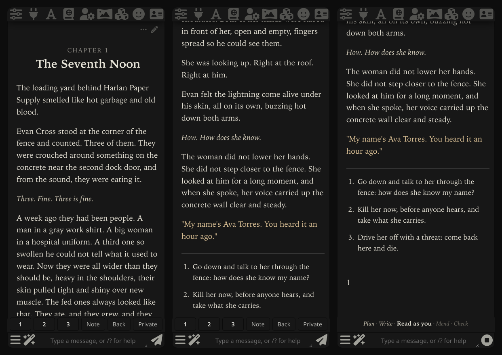

# writers-room

**A web novel you play as the hero, in SillyTavern. A room of AI models writes every chapter on your Claude or ChatGPT plan.**



You read a chapter. You press Continue, type what you do, or pick one of three roads at a crossroads. A few minutes later the next chapter is there, and the world has moved on its own.

**Why this exists.** I played AI roleplay in SillyTavern every night for weeks, and every chapter or two something felt off: a line nobody would say, a fact that changed, a world that politely did whatever I asked. I kept stopping to fix it, until fixing had replaced playing. This is the setup that finally let me just read. I don't play much anymore, so I'm sharing it the way I used it: one opinionated way of playing, not a toolkit. It's a side project with no roadmap, but issues and stories about how it went are welcome.

## Try it

You need [SillyTavern](https://github.com/SillyTavern/SillyTavern) and [Claude Code](https://docs.claude.com/en/docs/claude-code/overview) or [Codex](https://github.com/openai/codex), signed in with your plan. Then paste this to your agent:

```
Clone https://github.com/leonardomjq/writers-room and follow its AGENTS.md to set it up for me.
```

It sets everything up, asks you two questions about what you like to read, and starts the room. Refresh SillyTavern, accept its offer to connect, and **The Seventh Noon** opens on chapter 1:

*A week into the end of the world, a voice in every head names the ten strongest people in the city. You are number seven. Whoever kills one of the ten takes everything they carry. An hour later, the tenth name is standing at your gate.*

Next time, open your agent in the folder and say **play**. For anything else (a story of your own, your phone, an update, something that broke), just ask it.

## What the room does

An author keeps a secret bible of the world (who wants what, what moves while you're not looking, what was planted for later) and plans a few chapters ahead. Then every chapter goes through five steps, and you watch them on the page while it works:

1. **Plan**: what happens, who wants what, what it costs.
2. **Write**: one writer, one voice.
3. **Read as you**: a fresh model reads it knowing only what you know, and marks every line that would pull you out.
4. **Mend**: the writer fixes exactly those lines. The rest stays its words.
5. **Check**: the author holds it against the bible and every chapter before.

Step 3 is the one that changed everything. From a real draft:

> **Draft:** "On the fifth day two people went past you on Canal Street with a cart."
>
> **Reader:** She only sees light in living things, and a cart has no light. She was also across the river, so how does she know?

The author can't catch that, because the author knows too much. [More of what it catches](examples/what-the-room-catches.md), and [two full chapters](examples/) to judge for yourself.

## Playing

| On the Play bar | What it does |
|---|---|
| **Continue** | The next chapter, usually already written |
| **1 2 3** | At a crossroads, take that road |
| Type anything | Your own move, any time. The author bends the plan to it |
| **Note** | A question ("who is Cal again?"), a change that holds from then on ("shorter chapters, more danger"), or **Write this chapter again** |
| **Back** | Undo the last chapter. The story goes back with it |
| **Private** | Step out to your own model for a scene, then step back |

SillyTavern reads like a novel site: a book style, chapter headings, your place kept, and a recap when you come back after a while. On a phone, the page scrolls like a web-novel site, and you can lock the screen after a move and find the chapter when you come back. It only touches writers-room stories; your other chats stay as they are.

**Private scenes.** Claude and Codex won't write explicit scenes, so a chapter that reaches one ends at the door. Tap Private and play it on your own model: GLM, a local model, anything you use in SillyTavern. When you step back, your model sums the scene up in plain, non-graphic facts, and only those reach the author. The scene itself never goes to Claude or Codex. Adults only.

## Its opinions

- **Plain prose.** The default reader wants common words and no idioms. Ask for richer ones if you like.
- **You decide rarely, and big.** One crossroads every few chapters, and you can type anything in between.
- **A story, not a game.** No stats or bars on screen. Power shows in what the hero can do and how the world treats them.
- **A world that pushes back.** People want things, a no stands, and danger is real.
- **One version of each chapter.** No swipes. If you don't like it, say why and it's written again.

The default taste is web novels and progression fantasy. Change it by asking, in a Note or to your agent. [GUIDE.md](GUIDE.md) explains why each part exists, and it's the best read in here if you're into how AI writing goes wrong.

## What it isn't

- **Not a character chat.** No personas and no group chats. It's a novel, with you as the hero.
- **Not a new frontend.** It's SillyTavern, plus an extension and a small engine.
- **Not instant.** A chapter takes about 5 to 9 minutes, unless it was written ahead while you read.
- **Not free.** It uses a lot of your plan. Don't buy one just for this before you've read the [example chapters](examples/).
- **Not local.** Your own model plays Private scenes, but it can't run the room.
- **Not hosted.** It runs on your computer, which has to stay on while chapters are written.

## Questions

**How many chapters do I get on a $20 plan?** A rough estimate: a few dozen a week on ChatGPT with Codex, and a handful per sitting on Claude, maybe 10 to 20 a week. Claude writes the strongest chapters; Codex is solid and more plain. With both, the jobs are spread across them.

**Why not just a preset?** A preset changes how one model answers. It can't keep secrets from the writer, plan ahead and plant things, or have someone who knows only what you know read the chapter before you do.

**Can I run it on OpenRouter or my own model?** For Private scenes, yes. For the room, not really: a small model loses track of your move and writes too little. Your agent can try it on a strong one if you ask.

**Can I make my own story?** Ask your agent for a new story and give it a premise in a line or two, or hand it a SillyTavern card or lorebook.

**Where does my story go?** It stays on your computer. The only things sent anywhere are the prompts to your own Claude, Codex and Private models. There's no telemetry.

**What do I need besides a plan?** SillyTavern and Python 3.11, on macOS or Linux (on Windows, in WSL). Your agent checks the rest.

---

Everything technical (setup by hand, updating, removing it, phone access, the files) lives in [AGENTS.md](AGENTS.md), the manual your agent follows. MIT licensed.
